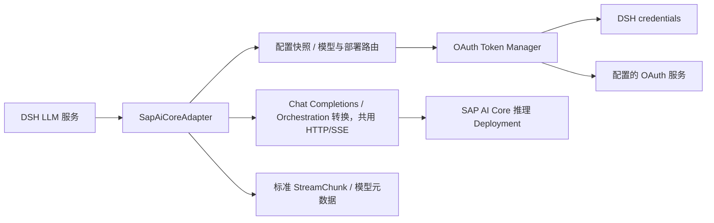

# dsh-sap-ai-core 插件实现 PLAN

为 DeepSeek Harness 提供 SAP AI Core 模型接入插件，统一处理企业认证、短期 Token、Resource Group、Deployment 路由、OpenAI 兼容 Chat Completions 和显式 Orchestration v2。cn40 Qwen 是第一个真实验证配置，地区、模型名称和部署编号都作为配置，而不是插件代码中的常量。

日期：2026-10-30；实施更新：2026-10-31。状态：S0–S4 已实现并完成独立验证；S5 短验收通过，S-L07 自然到期长测在刷新认证时发生 TRANSPORT 错误并退出，尚未通过。S6 独立候选版已安装到本地 DSH、推送 GitHub、发布 Release 并投稿社区，社区审核仍在等待。按用户确认的边界，kagent 的父 Agent 审批/拒绝、页面恢复和平台会话生命周期不属于本插件完成条件；S-L09 仅作可选联合记录，不继续扩大平台测试。阶段事实与验证命令见 [docs/progress.md](docs/progress.md)，完整证据矩阵见 [验收记录](docs/acceptance.md)，主传输决策见 [ADR 001](docs/adr-001-transport.md)。下文尚标注“拟定”的内容以实施记录为准。本插件不依赖 kagent，可以独立用于 DSH。

## 1 目标与支持范围

2026-10-31 新增用户要求：像 opencode auth 一样，共用一次认证并在 DSH 选择 Qwen 3.6 Plus、3.6 Flash、3.7 Plus、3.7 Max、3.8 Max。追加 S7：通过既有的共享 Orchestration 部署接入这五个模型；显式增加 sap-orchestration-v2 协议，复用认证、HTTP/SSE 和 DSH 转换。包中的 cn40 多模型配置提供五个入口；未知模型不会借用这些模型的 verified 能力声明。13:34 已完成五个模型的真实流式和工具闭环、中文上下文跨模型续接、并发认证与取消后恢复，19/24 请求。最新候选版本为 0.1.0-rc.4，打包、本地升级和发行记录见 docs/progress.md；不创建云端部署或扩展平台工作。

用户随后要求思考强度选项：同一 S7 提供关闭/低/中/高，使用经过验证的 enable_thinking 与 thinking_budget 预设，默认关闭；SAP 的思考块单独转换为 DSH reasoning。14:02–14:03 五模型全部选项已有成功证据，思考模式工具闭环均通过；Flash 高档的一次预算保护退出与单独补验如实分开记录。43 项确定性测试通过。

14:12 最终 rc.2 归档已在本地 DSH Desktop 0.2.1-rc.5 / Node 24.21.0 加载；五模型均返回关闭/低/中/高及默认关闭。Flash 低档的一次真实桌面请求收到 56 个 reasoning 增量并完成答案，usage=202（23 input、179 output，其中 173 reasoning，不重复相加）。已核对运行中的协议文件与最终 dist 摘要一致；临时观察插件已移除，DSH 正常重启，日常五模型配置与其他插件保持一致。归档 SHA-256 为 e9c4c6199049afd6b4387c3e0ea8dd55a836a5f853b4fb7de402c8d0a6b9c83f；脱敏证据为 .local/desktop-rc2/thinking-runtime-report.json 和 post-validation-state.json。

用户随后要求默认最高档，并以 128,000 Token 为最高预算分档。rc.3 将五模型的低/中/高设置为 32,000/64,000/128,000，默认 high；日常请求超时提高到 30 分钟。该值是显式请求的思考预算，不是借用 GPT 总输出容量声明 Qwen 厂商上限。先以有界短请求检查参数接受情况，再完成打包、本地安装与新版本发行；不覆盖已发布的 rc.1/rc.2。详细实测边界记录在 docs/compatibility.md。

14:53 已完成 rc.3 的 15 个参数组合调用，全部接口成功，五模型的默认高档均返回思考与答案。首批一次直接回答触发非空思考断言，原失败报告保留；续验只执行剩余 7 项。实际总用量 1933 Token，未进行生成满预算的压力测试。汇总为 .local/cn40-thinking-128k-acceptance.json；类型检查已通过，打包与桌面验证继续使用既有公开接口和独立安装流程。

14:58 rc.3 通过 npm run test:pack 的独立安装与 Agent 工具闭环检查，包括五模型的默认高档、显式中/低/关闭选项。最终归档 SHA-256 为 78dfd6ce694950766404da7a1ffc655bfe035ab53650cb6794b249afa0263cb2，87 个打包文件与工作树一致。已通过 DSH 自带 CLI 升级本地 desktop profile 并正常重启，保留原 ID、凭证引用和其他插件配置；安装包代码、版本和重启后的配置均已核对。安装及备份记录为 .local/rc3-delivery/install-state.json。

用户最新要求扩为五档，Max=128,000，其余均匀分配。rc.4 预设现为低/中/高/极高/Max = 25,600/51,200/76,800/102,400/128,000，默认 max，并保留 off。test:pack 同步验证五模型显示的全部选项及默认/显式请求参数；live thinking 入口同步六个选项及 40 次请求上限，但本轮不重新运行付费测试。128,000 沿用 rc.3 的参数接受证据，四个新中间值未分别补做 live 验证。升级保留模型 ID 和凭证引用，旧会话显式 high 改为 76,800，需要最高值时选择 Max；历史会话不批量迁移。

2026-10-31 rc.4 的 npm run typecheck、npm run test:pack 和 git diff --check 通过。打包测试在干净 DSH profile 检查五模型的六个选项、默认 Max 与逐档请求参数，并通过两种协议的 Agent 工具闭环及卸载重装。最终归档 SHA-256 为 289e74642e63d4ff600e8173e60a1b7e62cb62ce7b80488a93e55d8f291939b7，87 个打包文件与工作树一致。验证记录为 .local/rc4-delivery/validation.json。用户正常退出 DSH 后，已通过桌面自带 CLI 升级 desktop profile 并重启。安装的 87 个文件与 Release 归档一致，五模型均保存全部六个选项及默认 max；其他 profile 配置和依赖保持一致，重启后再次核对通过。备份与安装记录为 .local/rc4-delivery/install-state.json。本轮没有新增付费请求。

rc.4 源码提交为 [515f40e](https://github.com/solstice621/dsh-sap-ai-core/commit/515f40e18ac05ce0bbe9a3e051ce60537b0c3443)，[对应 CI](https://github.com/solstice621/dsh-sap-ai-core/actions/runs/41180525605) 通过确定性测试、干净打包安装和 dist 一致性；[v0.1.0-rc.4](https://github.com/solstice621/dsh-sap-ai-core/releases/tag/v0.1.0-rc.4) 已发布 tgz、manifest 和 SHA256SUMS，下载包与本地安装归档摘要一致。社区 [PR #10730](https://github.com/awesome-dsh-plugin/awesome-dsh-plugin/pull/10730) 已更新到 rc.4，并修正五档加关闭的说明；仅修改本插件条目，格式与目录检查通过。站点构建及社区审核状态以 PR 为准，仓库满一天时间为 2026-11-01 02:43:46（Asia/Shanghai）。

独立桌面交付记录（2026-10-31）：0.1.0-rc.1 已通过桌面版自带 CLI 安装到 desktop profile，并以用户已有 cn40 实例配置 sap-ai-core-cn40 / qwen-cn40。DSH 0.2.1-rc.5 自带 Node 24.21.0 上的 37 项确定性测试通过；实际桌面进程中的一请求验证收到 11 个真实增量，usage=55（23 input + 32 output）。已保留原有插件、配置与凭证，仅新增独立 SAP credential refs；临时验收插件已从 profile 移除。桌面安装归档 SHA-256：8530892283267df37cb620343d59c793b27e08e3c743b6d20530b812aceba6cc。独立发行使用 MIT、GitHub 源码及预编译 tgz，不等待 kagent 的剩余平台项；S5/S6 状态仍按上文保留。

安装插件后，用户选择一个 DSH provider 和逻辑模型，便能使用 SAP AI Core 上已经存在的模型 Deployment。插件负责 OAuth2 client credentials、Token 复用与刷新、推理地址选择、平台请求头、流式协议和错误转换，DSH 继续负责 Agent 循环及工具执行。

首个完整版本支持：

- SAP AI Core 下经过验证的 OpenAI 兼容 Chat Completions 接口。
- SAP Orchestration v2 completion，通过共享部署选择经验证的五个 cn40 Qwen 模型。
- 多个独立 AI Core 实例、Resource Group、provider route 和逻辑模型。
- 明确的 Deployment ID，以及可选的只读发现与唯一选择。
- 文本多轮、流式输出、工具调用、工具结果回传和取消。
- 模型能力声明、模型选择、配置变更和凭证轮换。
- 本地与 Kubernetes 两种配置方式，诊断输出和打包安装测试。

0.1.0-rc.1 不包含 Orchestration Service；S7 按用户要求增加其 v2 completion 协议。Anthropic 原生协议、Responses API、Embeddings、模型训练或部署创建仍不包含，不能因为都属于 SAP AI Core 就宣称已经兼容。

图片、结构化输出和 reasoning 参数按模型能力逐项启用。未知能力不自动开启；不支持的请求明确返回错误，不静默删掉用户选项。

## 2 已确认的基础与版本策略

| 事实 | 对设计的约束 |
| --- | --- |
| DSH 提供 `LlmAdapter` 和 provider 注册接口 | 插件接入公开模型层，不替换 Agent 循环 |
| DSH 凭证服务提供按引用读取与安全描述 | 配置保存引用，不能用可读 settings 暴露 client secret |
| DSH 每次模型 stream 是单次 provider attempt | SDK 内部重试关闭，模型重试由 DSH 失败步骤恢复处理 |
| DSH 公开导出 `PiAiAdapter` 和异步 `resolveApiKey` 钩子 | 可以评估协议复用，但不能假设已覆盖 SAP 路由、query 和 HTTP 错误要求 |
| 本机 cn40 具有 foundation-models 与共享 orchestration Deployment | 两种协议显式配置；原 Chat Completions 路径不被隐式替换 |
| SAP SDK 的公开模型客户端有自己的协议和路由范围 | 使用 SDK 前要验证 cn40 Qwen 路径，不以产品名称相同作为兼容证明 |

来源：[DSH Adapter 扩展说明](https://github.com/deepseek-ai/deepseek-harness/blob/dsh-v0.2.1-rc.5/docs/cookbook/adding-an-llm-adapter.md)、[凭证接口](https://github.com/deepseek-ai/deepseek-harness/blob/dsh-v0.2.1-rc.5/packages/credentials/credentials/README.md)、[PiAiAdapter 公开导出](https://github.com/deepseek-ai/deepseek-harness/blob/dsh-v0.2.1-rc.5/packages/llm/llm-pi-ai/src/index.ts#L77)、[SAP 连接方式](https://sap.github.io/ai-sdk/docs/js/connecting-to-ai-core)、[SAP Foundation Models 客户端](https://sap.github.io/ai-sdk/docs/js/foundation-models)。

S0 已固定 DSH 0.2.1-rc.5、Node 24.19.0、npm 11.17.0、Cordis 4.0.5 和 HTTP/SSE 客户端版本，并保留 package-lock.json。声明更宽 peer range 前，必须补充相应版本的 packed-package 测试。

本机 cn40 客户端的普通聊天样本只能作为请求形状参考，不能证明 streaming、tool_calls、长任务和 Token 刷新已经可用。真实能力由 S5 的验收结果决定。

## 3 架构和复用决定



S0 最终采用独立 SapAiCoreAdapter extends LlmAdapter，复用 DSH 的凭证、模型元数据和重试机制；主传输为 undici 8.12.3 + eventsource-parser 3.0.6。OpenAI 7.45.1 仅作开发对照，其干净 EOF 不报错的行为未满足本项目流完整性要求。插件只实现 SAP 平台逻辑和 DSH 协议转换；完整六项复用比较见 ADR 001。

进一步复用 `PiAiAdapter` 的探索限制在 S0。它已经提供异步凭证解析，但当前公开 hooks 未直接提供全部 SAP 请求级路由/query/原始 HTTP 状态控制；DSH 文档也说明 pi-ai 错误不保证稳定 HTTP status。只有下面六项都通过，才将默认实现替换为 PiAiAdapter 委托：

1. Token 每次请求动态取得，且不写入配置。
2. 不同模型可固定各自的 Deployment 和 `api-version`，没有全局可变 URL。
3. 401、403、429 和连接错误可可靠分类，非文本匹配。
4. 支持取消和真实增量工具参数，保留 DSH usage/replay 语义。
5. 不需要导入未打包的内部源码、修改 SDK 原型或设置全局 fetch。
6. 只存在一层可观察的模型重试。

S0 最多用一个工程日完成该比较并写 ADR；最终发布只保留一个主传输实现。若默认 SDK 同样无法满足 cn40 协议，改用范围明确的 HTTP/SSE 传输模块，并让同一套契约测试约束它。[PiAiAdapter hooks](https://github.com/deepseek-ai/deepseek-harness/blob/dsh-v0.2.1-rc.5/packages/llm/llm-pi-ai/src/adapter.ts#L84)、[pi-ai 已知限制](https://github.com/deepseek-ai/deepseek-harness/blob/dsh-v0.2.1-rc.5/packages/llm/llm-pi-ai/README.md#known-limitations-and-deferred-work)、[OpenAI Node SDK](https://github.com/openai/openai-node)。

拟定仓库布局：

```text
dsh-sap-ai-core/
  src/
    index.ts                   Cordis 入口、provider 注册与释放
    config.ts                  配置 schema 和不可变快照
    adapter.ts                 DSH LlmAdapter 实现
    auth/
      credentials.ts           凭证引用解析和配置变更检测
      token-manager.ts         Token 缓存、并发刷新和失效
      recovery.ts              有界认证失败恢复
    routing/
      deployments.ts           固定部署和只读发现
      endpoints.ts             URL、query、Resource Group 与主机校验
    protocol/
      request.ts               DSH 消息与工具转换
      stream.ts                增量、usage、finish、错误转换
      capabilities.ts          模型能力与兼容参数
    transport/                 客户端、代理、超时和取消
    diagnostics/               脱敏状态、错误和连接诊断
  examples/
    generic/
    cn40-qwen/
    kubernetes/
  tests/unit/
  tests/contract/fixtures/
  tests/integration/
  tests/live/
  docs/                        配置、兼容矩阵、诊断与维护
```

## 4 配置模型

### 4.1 三层配置

| 层次 | 保存内容 | 变更影响 |
| --- | --- | --- |
| AI Core instance | API 地址、Token 地址、credential refs、代理策略 | 认证与网络目标 |
| Provider route | instance 引用、Resource Group、协议、默认 API version | 一个 DSH provider 的平台配置 |
| Logical model | DSH 模型别名、上游 model、Deployment、能力与兼容参数 | 模型选择和具体请求 |

不将地区写进插件包名，不通过模型名自动猜测 SAP 地址。逻辑模型名用于 DSH 会话稳定引用，wire model 和 Deployment ID 可以独立配置。

### 4.2 拟定配置示例

```yaml
- insert:
    - id: sap-ai-core
      name: dsh-sap-ai-core
      config:
        instances:
          company-demo:
            apiBaseUrl: https://API_HOST
            tokenUrl: https://AUTH_HOST/oauth/token
            credentials:
              clientIdRef: SAP_AICORE_CLIENT_ID
              clientSecretRef: SAP_AICORE_CLIENT_SECRET
            oauth:
              clientAuthMethod: body
            network:
              proxyMode: environment
        providers:
          sap-ai-core-demo:
            instance: company-demo
            resourceGroup: default
            protocol: openai-chat-completions
            apiVersion: '2023-12-01-preview'
            models:
              - id: qwen-demo
                upstreamModel: qwen3.6-plus
                deployment:
                  id: REPLACE_WITH_RUNNING_DEPLOYMENT
                capabilities:
                  streaming: true
                  tools: true
                  parallelToolCalls: true
                  evidence:
                    status: verified
                    reference: docs/compatibility.md cn40 reference route
                compatibility:
                  systemRole: system
                  maxTokensField: max_tokens
                  includeUsage: true
                  parameters:
                    enable_thinking: false
                maxOutputTokens: 128
                defaultMaxTokens: 128
```

`apiVersion`、上游模型和兼容参数来自 cn40 示例的目标配置，实施时通过真实请求确认；它们不是所有 SAP AI Core 模型的全局默认值。`qwen-demo` 是本地逻辑别名。`API_HOST`、`AUTH_HOST`、Deployment 和 npm scope 由部署者填入，不把真实 client secret 放进示例。

运行 profile 必须挂载 DSH credentials 服务，并将凭证写入该服务或通过其环境回退提供。插件只在操作时解析引用，不扫描桌面、下载目录或任意 service-key 文件。可选导入工具只接受用户指定的 service key，校验后将 secret 写入凭证存储，配置只保存引用。

### 4.3 校验规则

- instance、provider 和 model ID 唯一；provider 路由冲突时保留原运行配置，拒绝新配置。
- deployment.id 与 deployment selector 互斥，不能混合产生不确定路由。
- Token URL 与 API URL 分别校验，必须使用 HTTPS；本地 mock 测试例外只能显式启用。
- `clientAuthMethod` 为 body 或 basic；不在失败后自动轮流尝试两种方式发送凭证。
- `apiVersion` 可选，未设置时不发送该 query；不能擅自给所有区域附加 cn40 参数。
- `Authorization`、`AI-Resource-Group` 等保留请求头由插件生成，普通自定义 headers 不允许覆盖它们。
- 自定义 endpoint 模板只能引用已知占位符，不能执行代码；Deployment ID 按单一路径段编码。
- 能力声明必须与已验证的 exact route/model 一致；配置改动从下一个请求开始生效。

## 5 OAuth 和凭证生命周期

使用 OAuth2 `client_credentials` 获取短期 access token。这里的“刷新”是重新申请 access token，不依赖某个并不存在的 refresh_token。

认证输入来自 `ctx.credentials.resolve()` 等公开凭证服务；只使用 `describe()` 一类无明文接口向 UI 展示配置状态。存储值与环境回退的优先级沿用 DSH，并在诊断中显示来源，不输出内容。[凭证读取与优先级](https://github.com/deepseek-ai/deepseek-harness/blob/dsh-v0.2.1-rc.5/packages/credentials/credentials/README.md)

Token manager 的拟定行为：

1. 每次准备请求时读取凭证及配置快照，识别凭证代次；client secret 变更立即切换到新缓存键。
2. 缓存键包括认证端点、client identity、scope/audience 和凭证代次，禁止跨租户或实例误用。Resource Group 若参与实际授权语义也进入键。
3. 依据权威 `expires_in` 计算到期时间，提前刷新窗口不超过 token 寿命的一半；窗口及抖动可配置。缺失或非法有效期返回明确认证响应错误，不能假定永久有效。
4. 同一键并发请求共享一次 token 获取；一次请求取消不能取消其他等待者需要的刷新。所有等待者都放弃时可结束未完成网络请求。
5. 刷新失败不覆盖已存在的新 token；未过期旧 token 的使用策略必须明确，过期 token 不得继续发送。
6. 401 只使实际被拒绝的 token generation 失效。旧请求迟到的 401 不得清除另一请求刚取得的新 token。
7. Token 只在进程内缓存，不写 profile、日志、会话、A2A metadata 或镜像。重启重新获取即可。

凭证变更通过每次操作重新解析保证；可以监听 DSH 更新事件清理缓存，但不能仅靠事件，因为外部进程环境变化不一定产生事件。正在执行的请求使用捕获的旧配置完成或失败，不在中途切换身份。

## 6 Deployment 路由

### 6.1 显式 Deployment 为默认模式

演示和首个可复现部署优先配置明确 Deployment ID、Resource Group 和逻辑模型映射。运行时不创建、启动、停止或删除任何模型 Deployment。

cn40 已知样本的请求结构为：

```text
POST {AI_API_URL}/v2/inference/deployments/{DEPLOYMENT_ID}/chat/completions
  ?api-version={CONFIGURED_API_VERSION}

Authorization: Bearer <short-lived-token>
AI-Resource-Group: <configured-group>
Content-Type: application/json
```

将推理根地址、Deployment 路径、`chat/completions` suffix 和 query 分别构造。不得简单拼出重复的 `/v1`、重复 `/chat/completions` 或把 query 塞入一个会再次被 SDK 拼接的 baseURL。

### 6.2 只读发现模式

S4 增加显式启用的 discovery。按配置的 Resource Group 查询 Deployment，并按 scenario、model、version 和状态过滤。cn40 的 foundation-models 路径是首个路由实现；不强制其他区域必须返回同样元数据。

选择规则：

- 只有符合条件且 RUNNING 的 Deployment 可用于新推理请求。
- 零候选返回部署未就绪；多个候选返回歧义，要求固定 ID 或更精确 selector，不能依赖列表顺序选择第一项。
- 管理 API 无权限时，显式部署模式应仍可直接推理；只读发现功能才报告权限不足。
- discovery 不修改用户配置，也不自动替换用户明确指定的 Deployment。
- 返回的 deploymentUrl 只在通过配置允许的 HTTPS origin 校验后使用；重定向不能把 Bearer Token 带到未知主机。
- 路由缓存按实例、Resource Group、模型、selector 和配置代次隔离；缓存 TTL 可配置。404/410 可使发现缓存失效，但不在同一模型尝试中悄悄换部署重发。

SAP 官方 SDK 文档证明 Deployment/Resource Group 是独立路由要素，但其默认选择方式不必照搬。本插件采用唯一选择以保证演示和后续请求的确定性。[官方路由概念](https://sap.github.io/ai-sdk/docs/js/foundation-models)

## 7 DSH 模型接口与协议转换

实现 provider 注册、provider 描述、模型列表、exact model 元数据、请求准备和流式输出。配置快照覆盖凭证引用、目标地址、模型、兼容参数及 retry policy；不能在一次调用中混用两代配置。

### 7.1 请求转换

必须保留系统提示词顺序、用户/助手历史、工具调用 ID、工具参数原始 JSON 和工具结果。不能修改 DSH 传入的冻结请求对象；转换使用新对象。

| 请求部分 | 处理规则 |
| --- | --- |
| provider/model | 选择逻辑模型后解析具体 Deployment 与 wire model |
| system/developer | 使用已验证的 role 策略；不能仅因模型会 reasoning 就改用 developer |
| tools | 名称、description 和 JSON Schema 保持语义，不执行工具 |
| tool calls/results | 保留 ID 和先后关系；结果交回模型后才能形成下一轮推理 |
| max tokens | 根据 exact route 的兼容配置选择字段并检查范围 |
| reasoning effort | 只接受模型声明的选项；协议参数由经过验证的模型配置决定 |
| stop、temperature 等 | 支持才发送，不支持时返回 UNSUPPORTED_OPTION |
| 图片与 structured output | 仅在相应能力测试通过后开放，否则明确拒绝 |

Qwen 相关 thinking 参数不要凭通用 OpenAI 经验猜测。S0/S5 用实际端点确认支持的字段和返回形状，再写为兼容配置与 fixture。

### 7.2 流式输出

输出遵守 DSH 的 `StreamChunk` 契约：

- block index 按首次出现顺序分配；同一个 block 的所有 delta 使用同一 index。
- 正文、reasoning、tool-call 分开；工具 arguments 使用原始 JSON 字符串增量，不在每个字符到达时重解析整个 JSON。
- 支持交错的多个 tool-call index，ID、name 和 arguments 可能在不同 chunk 到达。
- `block-end` 带组装后的完整内容；usage 在 finish 前发送；finish 后不再输出。
- 上游 finish_reason 到达后，仍读取合法的尾部 usage；不能提前结束丢掉计费信息。
- SSE 粘包、拆包、多字节字符、空 keepalive、usage-only chunk 和结束标记都进入测试。
- 流中断、非法事件和上游 in-band error 进入明确失败路径，不能把部分文本作为完整成功。
- 消费者提前退出、AbortSignal 和插件卸载必须关闭底层响应与计时器。

如果上游不支持真正 streaming，允许配置明确的 buffered 模式作诊断或受限使用，不能将最终 JSON 分割后宣称通过真实流式验收。[DSH StreamChunk 与用量类型](https://github.com/deepseek-ai/deepseek-harness/blob/dsh-v0.2.1-rc.5/packages/llm/llm/src/types.ts)

### 7.3 用量与历史

DSH `inputTokens` 表示未缓存输入，cacheRead/cacheWrite 另外记录。若上游 prompt_tokens 包含缓存命中，需要按明确的字段含义拆分；不能把命中数同时记入 input 与 cache 导致重复。上游不给明细时保留已知总量，不臆造缓存或 reasoning 数量。

`totalTokens` 只保留权威或可严格推导的结果。一个 attempt 的 usage 只发送一次；重试的费用和最终成功的费用在可观测性中分别归属，不用最终成功响应覆盖此前已产生的请求事实。

如果模型需要额外 reasoning/replay 字段才能继续工具调用，应通过 DSH 公开 replayState 机制保留最小必要内容，并验证同模型/跨模型切换。不向所有后续模型盲目回传某个 provider 的原生字段。

## 8 错误、重试与取消

### 8.1 错误分类

| 情况 | DSH 表达或拟定细分类 | 默认行为 |
| --- | --- | --- |
| 缺少 credential ref | MISSING_CREDENTIAL | 不请求网络 |
| 凭证或 OAuth 响应格式不合法 | INVALID_CREDENTIAL / AUTH，保留安全的子原因 | 不进行推理 |
| Token 服务拒绝 client | AUTH | 不循环换认证方式 |
| 推理明确返回 401 | AUTH，附 token generation 和可恢复标记 | 使该 token 失效，由有界认证恢复处理 |
| 403 | AUTH 或权限子原因 | 不作为 Token 到期无限刷新 |
| 部署未就绪或路由歧义 | 插件定义错误，映射到明确终态 | 不自动创建部署 |
| 429 | RATE_LIMIT 或权威 QUOTA | 按有界 policy 和 Retry-After 处理 |
| 5xx | SERVER | 可由 DSH 重试失败模型步骤 |
| 连接、DNS、TLS、代理失败 | TRANSPORT | 不降低 TLS 校验；给出分类诊断 |
| 请求或流空闲超时 | TIMEOUT | 取消底层请求，由 DSH 决定重试 |
| 用户取消 | ABORTED | 不重试 |
| 不支持的参数、坏流格式 | UNSUPPORTED_OPTION / 协议错误 | 明确失败，不静默修正 |

具体 stable code 与 DSH 错误类型对齐，在 S0/S1 固定。诊断保留 HTTP status、阶段、requestId 和脱敏子原因，不返回完整响应正文或认证头。

### 8.2 只有 DSH 拥有模型重试

最终 undici 传输没有模型重试；一个 adapter.stream 对应一次推理 attempt。正常瞬态失败使用 DSH llm-retry 的有界 normal policy，默认最多三次重试；不使用 always 模式作为公司模型的默认配置。SDK 对照仅用于开发，不参与运行时重试。

401 的自动恢复通过独立、可观察的认证恢复策略接入已存在的 `agent/request-error` waterfall：只处理本插件、明确拒绝的 token、尚未成功提交模型结果的失败步骤，每个逻辑失败步骤至多重新取 Token 并请求一次。记录恢复决定，并防止与通用重试预算叠加成循环。新 token 再次 401 或任何 403 都终止该恢复。

直接使用 `ctx.llm.stream()` 的调用者保持单次尝试：收到 AUTH 后，下一次显式调用会读取新 Token；插件不在已经暴露 partial chunks 的底层 stream 内偷偷重放。Token 获取本身的网络重试也要有限、有超时且可取消，与付费推理 attempt 分开记录。

流中断后的模型重试是新的 provider 请求，可能再次计费。DSH 负责撤销失败 attempt 的未提交输出和重新运行失败模型步骤；已经执行成功的工具不能被插件重新执行。

### 8.3 取消链

AbortSignal 必须贯穿 Token 等待、只读 discovery、推理请求、SSE 消费和 retry backoff。取消单个等待者不应影响其他会话正在共享的 Token refresh。每次取消后检查连接、迭代器和 timer 都释放，后续请求仍可运行。

## 9 网络和 Kubernetes 凭证

网络策略由运行环境提供。插件不更改 macOS 系统代理、VPN、DNS 或全局 Node transport。对当前本机环境，只有公司网络可达时才使用相应公司代理；在集群中使用集群明确配置的出口方式。

`proxyMode: environment` 必须通过实际客户端的代理能力支持 `HTTPS_PROXY`、`HTTP_PROXY` 和 `NO_PROXY`；不能假定 Node fetch 自动读取它们。传输选择在 S0 验证，包括 Token 与推理端点走不同 bypass 规则的情况。优先复用 DSH 现有网络能力，否则使用请求级 dispatcher，禁止修改全局 fetch。

Kubernetes 示例仅引用已有 Secret：

```yaml
env:
  - name: SAP_AICORE_CLIENT_ID
    valueFrom:
      secretKeyRef:
        name: sap-ai-core-credentials
        key: clientId
  - name: SAP_AICORE_CLIENT_SECRET
    valueFrom:
      secretKeyRef:
        name: sap-ai-core-credentials
        key: clientSecret
```

这是 Pod 容器配置片段，不是独立 Kubernetes 资源。通过环境注入的 Secret 更新通常需要重启 Pod 才能进入进程；若需要热轮换，应使用 DSH 可更新凭证存储或明确支持的文件挂载读取方式，并单独测试，不能把两者混为一谈。

TLS 按企业 CA 配置验证，不提供默认跳过验证模式。跨主机重定向、异常 deploymentUrl 和自定义 header 必须经过凭证转发约束。

## 10 配置界面与诊断

首个可交付版本同时提供 profile 配置和模型列表集成；Web 设置页可以复用 DSH settings/provider directory，但不能在浏览器中保存或执行 OAuth client secret 流程。

诊断分级，避免检查状态时意外触发模型推理：

| 诊断级别 | 执行内容 | 成功意味着什么 |
| --- | --- | --- |
| config | 检查 schema、模型映射、凭证引用状态 | 配置结构可用，不证明网络 |
| auth | 获取 Token，返回有效期和来源描述 | 认证成功，不证明部署可用 |
| deployment | 只读检查指定部署或 discovery 结果 | 路由就绪，不证明模型能力 |
| chat | 发出一条明确的测试 prompt | 该模型普通聊天成功 |
| stream | 验证真实增量事件和最终结果 | 该路由的 streaming 可用 |
| tools | 完整工具调用、结果回传、再次推理 | DSH Agent 核心链路成功 |

拟定诊断命令和 Web 操作都显式选择级别；健康检查只做无付费的本地检查。错误要能区分代理、认证、Resource Group、Deployment、协议兼容和模型能力。

日志字段包括 provider、逻辑 model、配置代次、请求阶段、脱敏部署标识、HTTP status、requestId、首 token 延迟、总耗时、usage 和取消原因。默认不记录 prompt、工具参数、service key、client secret 和 access token。

## 11 实施工作包

| 阶段 | 工作内容 | 输出 | 退出条件 | 依赖 |
| --- | --- | --- | --- | --- |
| S0 协议与复用验证 | 锁 DSH/SDK 版本；确认 cn40 请求和能力；比较 PiAiAdapter 与 SDK；验证代理 | 协议 fixture、兼容矩阵、ADR | 主传输方案确定，流式和工具请求形状有证据 | 模型访问及既有部署 |
| S1 插件基础 | schema、provider 注册、逻辑模型、配置快照、凭证引用、打包 | 可安装插件和 generic 示例 | 干净 DSH profile 可安装、列模型、卸载 | S0 |
| S2 认证 | Token manager、单飞刷新、凭证代次、401 恢复、脱敏 | OAuth 模块及并发测试 | 过期、轮换、取消、旧 401 竞争等场景通过 | S1 |
| S3 推理 | URL/query、消息和工具转换、SSE、usage、finish、错误 | LlmAdapter 与传输 | DSH 契约测试通过，无隐藏 SDK 重试 | S2 |
| S4 完整配置与运维 | 只读 deployment discovery、能力解析、诊断、Kubernetes 示例 | 配置文档与诊断入口 | 多实例不串路由，显式部署不依赖管理权限 | S3 |
| S5 真实 Agent 验证 | cn40 Qwen 流式、工具闭环、多轮、取消、到期刷新 | 实测报告和脱敏 fixture | 核心 live 验收通过，未支持能力明确 | S3、S4 |
| S6 独立打包与交付 | pack 测试、本地 DSH 安装、升级回滚、文档、GitHub 和社区投稿 | 版本化构建、发行和投稿记录 | 满足第 13 节的独立交付要求；候选版明确剩余验证和审核状态 | S1–S4、S5 实测边界；不依赖 kagent |
| S7 共用认证的五模型与思考选择 | 显式 Orchestration v2、五模型及思考预算预设、独立安装升级 | rc.4、实测矩阵及稳定逻辑 ID | 五模型流式/工具、切换/取消、干净安装和本地更新；rc.4 五档及关闭选项的参数映射检查，未实测中间预算与社区状态如实记录 | S1–S4、既有 Orchestration 部署；不依赖平台工作 |

初估 S0–S3 为 3–5 个工程日，S4–S6 为 2–4 个工程日。前提是能访问已有模型 Deployment，且端点支持必要的 streaming 和 tools。模型平台限制、账号申请和网络排障不计入；S0 后重估。两插件的代码工作可独立推进，但完整真实联调依赖两边核心功能均通过。

## 12 测试与验收矩阵

### 12.1 确定性测试

| ID | 场景 | 通过标准 |
| --- | --- | --- |
| S-T01 | tgz 安装到干净 DSH | 只使用公开入口，能注册、选择和卸载 provider |
| S-T02 | 凭证缺失、空值、错误引用 | 网络请求前明确失败，日志无 secret |
| S-T03 | body/basic OAuth 请求 | 仅按配置发送一种认证方式，URL/form 编码正确 |
| S-T04 | N 个请求同时遇到 Token 到期 | 同一键只发一次刷新，不同实例互不阻塞 |
| S-T05 | 取消一个 Token 等待者 | 其余请求仍完成，取消者不继续推理 |
| S-T06 | 凭证轮换及迟到 401 | 新 Token 不被旧失败清除，下一请求用新凭证 |
| S-T07 | 连续 401、403、错误 expires_in | 恢复有界，权限错误不形成刷新循环 |
| S-T08 | URL、query、header 组合 | 无重复路径，api-version 可省略，保留头不可覆盖 |
| S-T09 | discovery 零个、一个、多个候选 | 分别报未就绪、确定选择、报歧义 |
| S-T10 | 多实例、Resource Group、模型同时调用 | Token、Deployment、model 和 header 不交叉污染 |
| S-T11 | 中文、多字节、SSE 拆包粘包 | 文本完整，block index 与顺序正确 |
| S-T12 | 多个交错工具调用和大 arguments | ID 配对，参数无损，无每字符全量 JSON 重解析 |
| S-T13 | 尾部 usage、无 usage、空 choices | usage 在 finish 前，未知统计不伪造 |
| S-T14 | 流中断、in-band error、超时 | 唯一失败终态，无错误后的成功 finish |
| S-T15 | 取消、迭代器提前退出、HMR | 连接释放，没有后台继续输出或旧配置混用 |
| S-T16 | 429、5xx、Retry-After | 只有 DSH 层重试，次数和等待可观察且可取消 |
| S-T17 | 不支持的 stop、reasoning、image | 明确拒绝，不静默删字段 |
| S-T18 | TLS、代理、NO_PROXY、异常重定向 | 使用预期网络路径，不转发凭证到未知主机 |
| S-T19 | 缓存与 reasoning token 统计 | 不重复累计，权威总量保留 |
| S-T20 | 模型切换与必要 replay metadata | 历史可用，外来模型不收到无效原生字段 |

使用本地 OAuth 和推理 mock server 精确记录请求、延迟、并发和连接关闭。fixture 必须删除真实凭证与业务 prompt。mock 的价值是证明插件控制逻辑，不能作为真实 Qwen 能力证明。

### 12.2 真实 cn40 Qwen 测试

| ID | 场景 | 通过标准 |
| --- | --- | --- |
| S-L01 | 认证与明确 Deployment | 正确实例和 Resource Group，部署可用于推理 |
| S-L02 | 普通聊天与中文多轮 | 上下文连续，回答不为空，model/usage 可解释 |
| S-L03 | 真实 streaming | 最终完成前收到多个可解释的增量事件 |
| S-L04 | 工具调用闭环 | 模型发 tool_calls，DSH 执行受控工具，结果回传后产生后续回答 |
| S-L05 | 多工具或大参数 | 上游实际支持时验证；未支持则能力矩阵明确，不冒充已支持 |
| S-L06 | 运行中取消 | HTTP 消费和 Agent 等待结束，后续会话仍能使用 |
| S-L07 | 跨 Token 到期的新模型步骤 | 自动取得新 Token，无人工替换 key，不重放已执行工具 |
| S-L08 | 两个独立会话并发 | 会话和配置不混用，单飞刷新有效 |
| S-L09（可选） | 另行要求联合交付时由 kagent 调用完整任务 | 平台负责工具与审批展示和任务取消传递；不作为本插件完成条件 |

S-L07 应等待自然到期或使用受控测试凭证策略；缩短本地刷新窗口只能证明主动刷新路径，不能冒充真实过期恢复验收。无法完成的真实项标为未验证并保留原因，不用 mock pass 替代。

模型插件的独立验收以 S-T 测试和 S-L01–S-L08 为准。S-L09 属于可选的两插件联合交付，既不作为 S5/S6 的前置条件，也不阻塞本插件完成。已有平台证据和未验证项单独保留，不把平台审批、页面恢复或任务管理扩入模型插件。

拟定脚本为 `test:contract`、`test:integration`、`test:live:cn40`、`test:pack`。live 测试显式启用并设置小请求预算，CI 默认运行确定性测试，不隐式使用个人公司凭证。

## 13 发布与回滚

独立 DSH 演示里程碑要求 S-L01–S-L04、S-L06 通过。若上游不支持必要 streaming 或 tools，应直接调整演示能力说明或模型选择，不能把一次普通聊天包装成完整 Agent 接入。候选版可以明确披露 S5 尚未完成的长测；完整稳定版不能将未通过项标成通过。

首个完整版本交付：

- 可独立安装的 npm 包或 tgz，明确的 DSH/Node/SDK 兼容范围。
- generic 配置、cn40 Qwen 示例、Kubernetes Secret 引用和诊断操作。
- 凭证与 Token 生命周期说明、错误分类、retry policy、网络与 TLS 配置。
- 确定性测试结果、真实能力矩阵、可复现工具闭环和版本 lockfile。
- 独立 DSH 使用方式与安装记录；如有 kagent 联调，附可选记录，不要求平台功能验收通过。

通用性分层声明：配置和 mock 能证明实例、地区、Resource Group 和模型参数化；只有 cn40 真实验证时，应写“首个已验证环境为 cn40 Qwen”，不能写“所有 SAP AI Core 模型都已兼容”。增加第二个真实环境后再扩大已验证矩阵。

升级前保存配置和凭证引用，不导出明文 Token。回滚恢复上一插件包和配置；Token 缓存可直接丢弃。逻辑 provider/model ID 需要稳定，删除或重命名会影响已有 DSH 会话，因此提供显式迁移说明。

## 14 与 dsh-kagent 的接口

共享配置示例：

```text
provider route: sap-ai-core-demo
logical model: qwen-demo
wire model: qwen3.6-plus
Deployment / Resource Group / credentials: 由 SAP 插件配置
```

| 责任 | dsh-sap-ai-core | dsh-kagent |
| --- | --- | --- |
| 企业模型认证 | OAuth、Token、凭证引用 | 只挂载或引用运行环境 Secret |
| 模型调用 | 路由、协议、模型能力、StreamChunk | 使用 DSH 模型选择，不关心 SAP 请求格式 |
| 工具 | 接收工具定义，返回工具调用 | 通过 DSH 执行与展示，桥接审批 |
| 取消 | 取消模型传输及认证等待 | 从 kagent task 传递到 DSH |
| 会话 | 保留模型协议所需 replay 信息 | 管理 context/task 和平台生命周期 |
| 用量与错误 | 提供权威 usage 和标准失败 | 转换为平台事件，不重复计数 |

两个插件在同一 profile 中组合，不相互导入内部模块。SAP 插件关闭或替换后，dsh-kagent 仍能使用其他 provider；kagent 不运行时，SAP 插件仍能在普通 DSH 中工作。

## 15 实施前必须关闭的决策

| 决策 | 默认方案 | 关闭条件 |
| --- | --- | --- |
| 协议复用 | 独立 LlmAdapter 加经过验证的 SDK | S0 六项复用条件和真实 URL/query 测试决定是否改用 PiAiAdapter |
| 认证形式 | 从已知配置选择 body 或 basic | 真实 OAuth endpoint 验证，不自动探测 |
| Deployment 选择 | 明确 ID | 有只读权限且 selector 唯一时才启用 discovery |
| cn40 模型能力 | 文本、streaming、tools 为目标 | S-L02–S-L04 实测；reasoning/image 独立声明 |
| 配置热更新 | 不可变快照，下一请求生效 | HMR、凭证轮换和并发测试通过 |
| 401 自动恢复 | DSH 失败步骤层最多一次 | waterfall 顺序、持久记录和通用重试互斥经过测试 |
| 网络集成 | 请求级代理与现有 DSH 网络能力 | 本地和 Pod 中 Token/推理两条链路均验证 |

S0 的结果应同时更新本计划中的候选项、兼容矩阵和配置示例，然后按工作包执行。不会因为某个通用 SDK 已有 SAP 字样，就跳过 cn40 的真实协议和工具链路验收。
